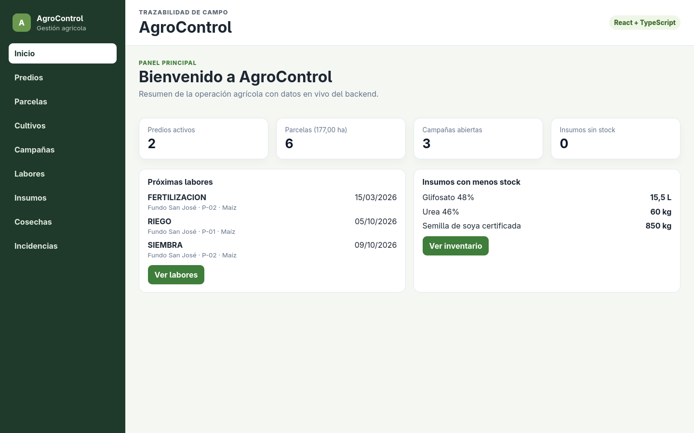
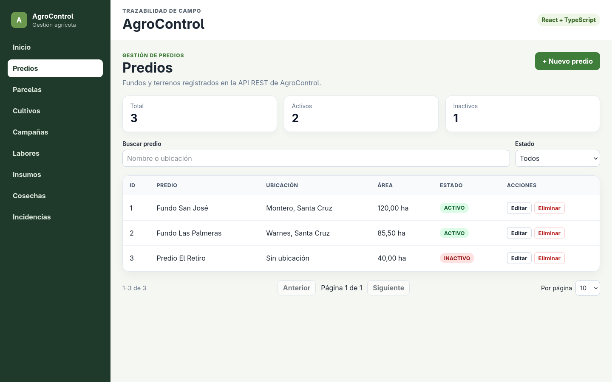
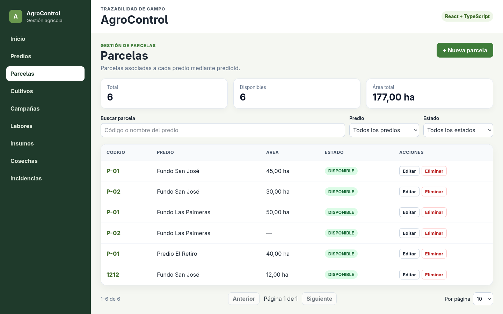
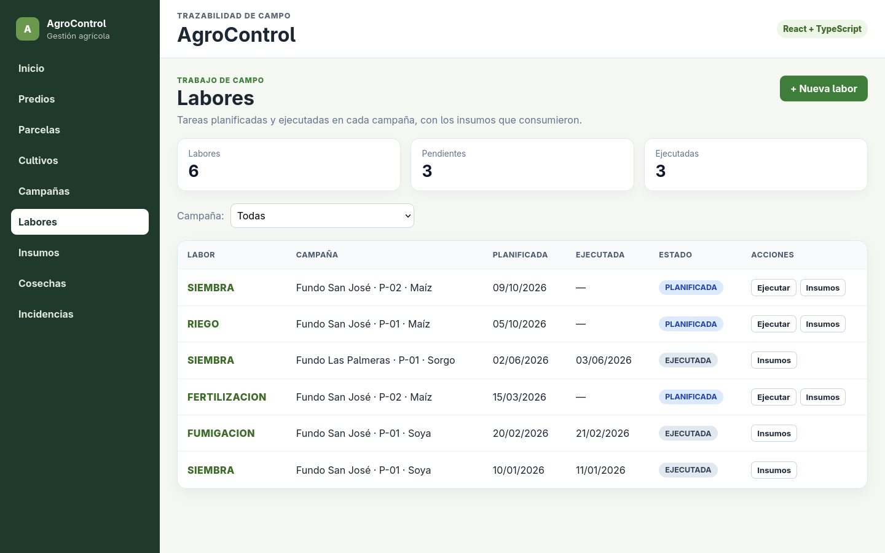
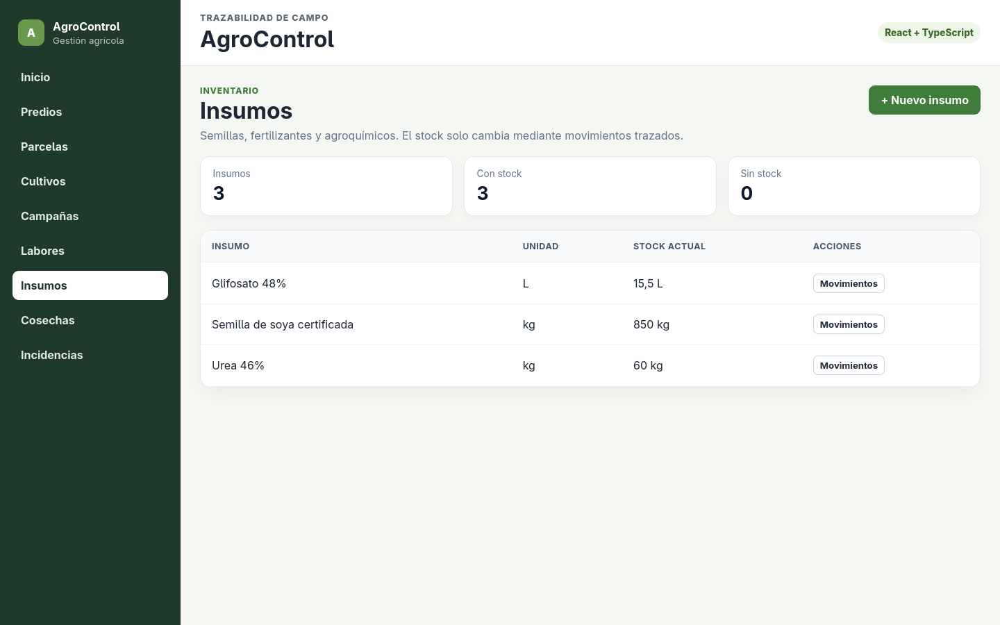
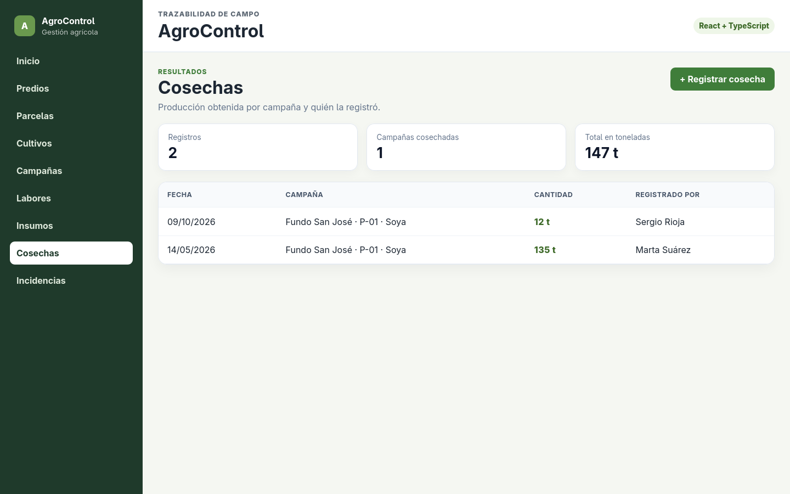

# AgroControl

Sistema de gestión de lotes agrícolas: predios, parcelas, campañas, labores, insumos y cosechas.

## Inicio rápido (sin instalar Java, Node ni PostgreSQL)

Solo hace falta **Docker** ([Docker Desktop](https://www.docker.com/products/docker-desktop/) en Windows/Mac).

| Sistema | Encender | Apagar |
|---|---|---|
| Windows | doble clic en **`iniciar.cmd`** | doble clic en `detener.cmd` |
| Linux / Mac | `./iniciar.sh` | `./detener.sh` |

Se abre solo en **http://localhost:8080**. La primera vez tarda unos minutos porque arma todo; después arranca en segundos y los datos quedan guardados.

| Entrar como | Email | Contraseña |
|---|---|---|
| Administrador (ve todo) | `sergio@agrocontrol.com` | `agro123` |
| Jefe de campo | `jefe@agrocontrol.com` | `agro123` |
| Operario | `operario1@agrocontrol.com` | `agro123` |
| Almacenero | `almacen@agrocontrol.com` | `agro123` |
| Supervisor | `supervisor@agrocontrol.com` | `agro123` |

En la pantalla de login también hay un botón por rol que completa el usuario. Para empezar con la base limpia: `docker compose down -v` y volver a iniciar.

### ¿Algo no anda?

| Mensaje | Qué hacer |
|---|---|
| "Falta Docker" / "Docker no está abierto" | Instalar o abrir Docker Desktop y esperar a que diga *running* |
| "port is already allocated" (8080 o 5433) | Otra cosa usa ese puerto: cerrar el backend que esté corriendo con `mvn`/IntelliJ, o el otro Postgres |
| "No respondió a tiempo" | Ver el error con `docker compose logs app` |
| La web dice "Debe iniciar sesión" | La sesión venció (dura 8 h): volver a entrar |

### Para programar

```bash
docker compose up -d db                          # 1. solo la base (puerto 5433)
cd backend                                       # 2. API en http://localhost:8080
AGROCONTROL_DB_URL=jdbc:postgresql://localhost:5433/agrocontrol ./mvnw spring-boot:run
cd frontend && npm install && npm run dev        # 3. en otra terminal: web en http://localhost:5173
```

`./mvnw` (o `mvnw.cmd` en Windows) descarga Maven solo: no hace falta instalarlo. Las pruebas: `./mvnw test` en `backend/` y `npm run test:run` en `frontend/`; GitHub las corre en cada PR (`.github/workflows/ci.yml`).

## Capturas

| Panel principal | Predios |
|---|---|
|  |  |
| **Parcelas** | **Labores** |
|  |  |
| **Insumos** | **Cosechas** |
|  |  |

## Estructura del repositorio

```
AgroControl/
├── iniciar.sh / .cmd   Arranca todo con Docker (y detener.sh / .cmd lo apaga)
├── compose.yaml        Base de datos + aplicación
├── backend/            API REST · Java 21 + Spring Boot + JPA + Flyway
├── frontend/           Web · React + TypeScript + Vite
├── agrocontrol-mobile/  App móvil de las guías · React Native + TypeScript (Expo)
├── database/           Scripts SQL de clase (ver database/README.md)
└── docs/               Visión, glosario, requerimientos y decisiones
```

## 1. Problema
Reemplazar el registro manual y disperso de la operación agrícola por un sistema digital que dé trazabilidad completa — quién hizo qué, cuándo, con qué insumos, y con qué resultado — a nivel de parcela y campaña, sin tomar decisiones agronómicas por el usuario.
## 2. Objetivo del MVP 
Desarrollar un sistema web/móvil para planificar campañas, registrar labores e insumos, controlar responsables y capturar cosechas, ofreciendo una bitácora completa por parcela. 

## 3. Actores principales
- Administrador
- Jefe de campo 
- Operario 
- Almacenero 
- Supervisor
 ## 4. Alcance inicial 
- Predios y parcelas 
- Cultivos
- Campañas 
- Labores
- Asignaciones 
- Insumos 
- Movimientos de insumos
- Bitacora de campo 
- Cosecha
- Incidentes 
- Dashboard 
## 5. Fuera de alcance
 - Sensores IoT
- Barreras físicas 
- Facturación fiscal
- GPS en tiempo real 
- IA para autorizar reservas o calcular precios
 ## 6. Stack objetivo del semestre 
- Backend: Java 21 + Spring Boot
- Base de datos: PostgreSQL + Flyway 
- Web: React + TypeScript 
- Móvil: React Native + TypeScript 
- Pruebas API: Postman
- Contenedores: Docker / Docker Compose 
- Versionado: Git + GitHub 
- CI: GitHub Actions - IA: Spring AI, únicamente como capacidad complementaria
 ## 7. Estado actual 
- Documentación de visión, glosario, backlog y modelo relacional v0.1.
- Base de datos PostgreSQL versionada con Flyway.
- Backend con API REST de roles, usuarios, predios, parcelas, cultivos, campañas, labores, insumos y cosechas, con validación, CORS y Swagger.
- Frontend web conectado a la API para todo el flujo: predio → parcela → campaña → labores e insumos → cosecha.
- App móvil (Expo) conectada a la misma API: mis labores, detalle de labor (ejecutar y registrar consumo) y parcelas con sus campañas.
- Pendiente: incidencias, bitácora de campo, asignación de labores, auditoría, autenticación y tests automatizados.
 ## 8. Documentación 
- `docs/01-vision/vision-v0.1.md` 
- `docs/01-vision/glossary-v0.1.md` 
- `docs/02-requirements/backlog-v0.1.md`
- `docs/02-requirements/model-relational-v0.1.md`
- `docs/02-requirements/matriz-rf-rn-parcial1.md` (18 RF y 10 RN del banco, con corte, estado y evidencia)
- `docs/02-requirements/casos-de-uso-flujo1.md` (casos de uso del primer flujo en Given-When-Then)
- `docs/03-decisions/` 
## 9. Regla de trabajo
 Cada cambio importante debe ser comprensible, trazable y defendible. El repositorio es la fuente de verdad del proyecto

## 10. Base de datos
El backend (`backend/`) usa Spring Boot + Spring Data JPA + Flyway sobre PostgreSQL.

1. Crea una base de datos local vacía llamada `agrocontrol` en PostgreSQL (Flyway crea el esquema `agrocontrol` y las 15 tablas automáticamente al arrancar y aplica las migraciones V1 a V4: esquema, semilla, contraseñas de demo y `CHECK` de estados; ver [`database/README.md`](database/README.md)). Con Docker también sirve `docker compose up -d`, que levanta Postgres 17 en el puerto 5433.
2. Configura las credenciales por variables de entorno (opcional, ya tienen valores por defecto para desarrollo local):
   - `AGROCONTROL_DB_URL` (por defecto `jdbc:postgresql://localhost:5432/agrocontrol`)
   - `AGROCONTROL_DB_USER` (por defecto `postgres`)
   - `AGROCONTROL_DB_PASSWORD` (por defecto `postgres`)
3. Ejecuta la clase `com.agrocontrol.AgroControlApplication` (no `Main`, que sigue siendo solo una demo en memoria sin base de datos). Al iniciar, Flyway aplica la migración y la app imprime cuántos roles hay en la base de datos, confirmando la conexión.

El script original del esquema (`database/V1__esquema_inicial.sql`, dump de `pg_dump`) se mantiene como documentación de referencia; la copia ejecutada por Flyway vive en `backend/src/main/resources/db/migration/`. Los demás scripts de `database/` (creación manual, semilla y pruebas) se describen en [`database/README.md`](database/README.md).

## 11. API REST
Con el backend en marcha (`http://localhost:8080`). Swagger UI: `http://localhost:8080/swagger-ui.html`. Ejemplos listos en [`requests.http`](requests.http).

| Recurso | Endpoints | Reglas principales |
|---------|-----------|--------------------|
| Roles | `GET/POST /api/roles`, `GET/PUT/DELETE /api/roles/{id}` | Nombre único (409); no se borra un rol con usuarios (409) |
| Login | `POST /api/auth/login`, `GET /api/auth/me` | Email o contraseña incorrectos dan el mismo 401; usuario inactivo no entra |
| Usuarios | `GET/POST /api/usuarios`, `GET /api/usuarios/{id}` | Rol existente (404); email único (409); contraseña con BCrypt |
| Predios | `GET/POST /api/predios`, `GET/PUT/DELETE /api/predios/{id}` | No se borra un predio con parcelas (409) |
| Parcelas | `GET/POST /api/parcelas?predioId=`, `GET/PUT/DELETE /api/parcelas/{id}` | Código único por predio (409); no se borra con campañas (409) |
| Cultivos | `GET/POST /api/cultivos` | Nombre único (409) |
| Campañas | `GET/POST /api/campanas?parcelaId=`, `POST /{id}/iniciar`, `POST /{id}/finalizar`, `GET /{id}/avance` | Una campaña abierta por parcela (409); transiciones PLANIFICADA → EN_CURSO → FINALIZADA |
| Labores | `GET/POST /api/labores?campanaId=`, `POST /{id}/iniciar`, `POST /{id}/ejecutar`, `GET/POST /{id}/consumos`, `GET /asignaciones`, `POST /{id}/asignaciones` | No se planifica, ejecuta ni consume en una campaña finalizada (409); el consumo descuenta stock y registra una SALIDA en la misma transacción; el operario solo toca sus labores asignadas (403) |
| Insumos | `GET/POST /api/insumos`, `PUT /api/insumos/{id}`, `GET /api/insumos/salidas?desde=&hasta=`, `GET/POST /api/insumos/{id}/movimientos` | El stock solo cambia por movimientos; no puede quedar negativo (409); la fila se bloquea (`SELECT … FOR UPDATE`) para que dos movimientos simultáneos no se pisen. Cada insumo tiene categoría (semillas, fertilizantes, agroquímicos, **combustibles**, **aceites y grasas**, **repuestos**, otros) y stock mínimo que avisa "por agotarse"; `/salidas` suma lo que salió del almacén en el período (por defecto, el mes) |
| Cosechas | `GET/POST /api/cosechas?campanaId=` | Solo campañas EN_CURSO o FINALIZADA (409) |
| Incidencias | `GET/POST /api/incidencias?parcelaId=`, `POST /{id}/atender`, `POST /{id}/resolver` | Parcela, campaña o labor (al menos una) y coherentes entre sí; ABIERTA → EN_ATENCION → RESUELTA (resolver pide cómo); las cierran administrador, jefe y supervisor |
| Bitácora de campo | `GET/POST /api/labores/{id}/bitacora`, `GET /api/parcelas/{id}/bitacora` | RF-09 y RF-14. Se cierra cuando la campaña se finaliza (409); el operario solo anota en sus labores (403) |
| Auditoría | `GET /api/auditoria?entidad=&idEntidad=` | RF-16, solo ADMINISTRADOR. Se llena sola: los casos de uso marcados con `@Auditable` (crear, editar o borrar predios y parcelas, transiciones de campaña y labor, stock, cosechas, usuarios y roles) dejan quién, qué y cuándo |

- Errores con formato `ProblemDetail` (`type`, `title`, `status`, `detail`, `instance` y `errores` por campo en los 400), desde `GlobalExceptionHandler`.
- CORS autoriza `http://localhost:5173` (web) y `http://localhost:8081` (Expo web) por defecto; se cambia con `AGROCONTROL_CORS_ORIGINS`.
- Tests: `mvn test` corre los unitarios (Mockito y MockMvc con la seguridad real) y `PersistenciaPostgresTest`, que levanta un PostgreSQL 17 con Testcontainers para probar migraciones, mapeos y el bloqueo de stock. Sin Docker ese test se salta.

### Login y permisos por rol
Toda la API (salvo `POST /api/auth/login`, `/api/health` y Swagger) exige `Authorization: Bearer <token>`. El token es un JWT HS256 que dura 8 h; su `sub` es el id del usuario, y el backend lo usa como "quién registra" en cosechas, consumos, movimientos e incidencias (el cliente ya no manda `usuarioId`). `SecurityConfig` aplica la matriz de permisos: **401** sin token y **403** si el rol no puede hacer la operación. La web oculta además lo que el rol no puede usar.

| Rol | Email | Ve / puede |
| --- | --- | --- |
| Administrador | sergio@agrocontrol.com | Todo, incluidas las pantallas Usuarios y Auditoría; único que edita predios y parcelas |
| Jefe de campo | jefe@agrocontrol.com | Cultivos, campañas, planificar labores y asignar operarios, cosechas, incidencias y bitácora |
| Operario | operario1@agrocontrol.com | "Mis labores" (solo las asignadas): ejecutar, registrar insumos usados, anotar en la bitácora y reportar incidencias |
| Almacenero | almacen@agrocontrol.com | Insumos y movimientos, registrar cosechas |
| Supervisor | supervisor@agrocontrol.com | Todo en lectura e indicadores; además registra incidencias y observaciones de campo (RF-09, RF-12) |

Contraseña de demo de todos: `agro123` (migración `V3__usuarios_login.sql`). La clave de firma se cambia con `AGROCONTROL_JWT_SECRET` (mínimo 32 caracteres) y la duración con `AGROCONTROL_JWT_HORAS`.

### Arquitectura por módulo
```
<modulo>/
├── domain/                       Entidad + puerto de salida (<Entidad>Repository)
├── application/                  Casos de uso (<Entidad>Service, sin anotaciones de Spring salvo @Transactional)
└── infrastructure/
    ├── config/                   @Bean que crea el servicio
    └── adapter/
        ├── in/web/               @RestController + DTOs (records)
        └── out/persistence/      JpaRepository + PersistenceAdapter (implementa el puerto)
```
El dominio no conoce JPA: cada entidad tiene su `*JpaEntity` y su `*PersistenceMapper` en `out/persistence/`, y los estados son `enum` del dominio (ver `docs/06-defensa/notas-capitulo-05.md`).

## 12. Frontend web
React + TypeScript + Vite en `frontend/`, organizado por features: `auth`, `predios`, `parcelas`, `cultivos`, `campanas`, `labores`, `insumos`, `cosechas`, `incidencias` y `usuarios`. Se entra con login, y el menú, las rutas y los botones dependen del rol. El panel de inicio resume la operación con datos en vivo.

```bash
cd frontend
npm install
npm run dev
```

La URL de la API se configura en `frontend/.env.development` (`VITE_API_URL=http://localhost:8080/api`). Las variables `VITE_` terminan en el navegador: nunca guardar secretos ahí.

### Una sola aplicación (entrega / despliegue)
El perfil Maven `fullstack` compila el frontend y lo mete en el jar del backend, que sirve la web y la API desde el mismo puerto (sin CORS):

```bash
cd backend
./mvnw -Pfullstack package
java -jar target/AgroControl-1.0-SNAPSHOT.jar   # web en http://localhost:8080, API en /api, Swagger en /swagger-ui.html
```

El perfil descarga su propio Node en `backend/target/` (no hace falta tenerlo instalado) y construye con `npm run build:jar`, que usa `frontend/.env.jar` (`VITE_API_URL=/api`). Las rutas de React (`/predios`, `/parcelas`...) las resuelve `SpaConfig`, que responde `index.html`. Para desarrollar se siguen usando `./mvnw spring-boot:run` y `npm run dev` por separado. El `Dockerfile` de la raíz hace exactamente esto dentro de un contenedor (lo usan `iniciar.sh` / `iniciar.cmd`).

## 13. App móvil
Expo + React Native + TypeScript en `agrocontrol-mobile/`, la app de las guías móviles (01 y 02, más la vista de siembras). Adapta ParkFlow360 Mobile al dominio de AgroControl (Predio → Parcela, 1:N) y por ahora usa datos de demo, sin API ni login. Detalle de cada guía en [`agrocontrol-mobile/README.md`](agrocontrol-mobile/README.md).

```bash
cd agrocontrol-mobile
npm install
emulator -avd AgroControl &   # o encenderlo desde el Device Manager de Android Studio
npm run android               # instala Expo Go en el emulador y abre la app
```

Expo encuentra el emulador con `ANDROID_HOME` (normalmente `~/Android/Sdk`). Si dice "No Android connected device found", falta esa variable o el emulador no está encendido.

## 14. Estrategia Git
- `main` es la rama estable: siempre compila y arranca.
- Cada tema se trabaja en una rama propia (`feat/...`, `fix/...`, `docs/...`, `defensa/...`) y entra a `main` con un pull request revisado por otro integrante, por ejemplo `defensa/cierre-gaps`.
- Los commits siguen Conventional Commits (`feat(api): ...`, `fix: ...`, `docs: ...`, `chore: ...`), un cambio coherente por commit.
- Remotos del equipo: `origin` (SalinasMiguel/AgroControl) y el fork `NeckHurtttt/AgroControl`.

