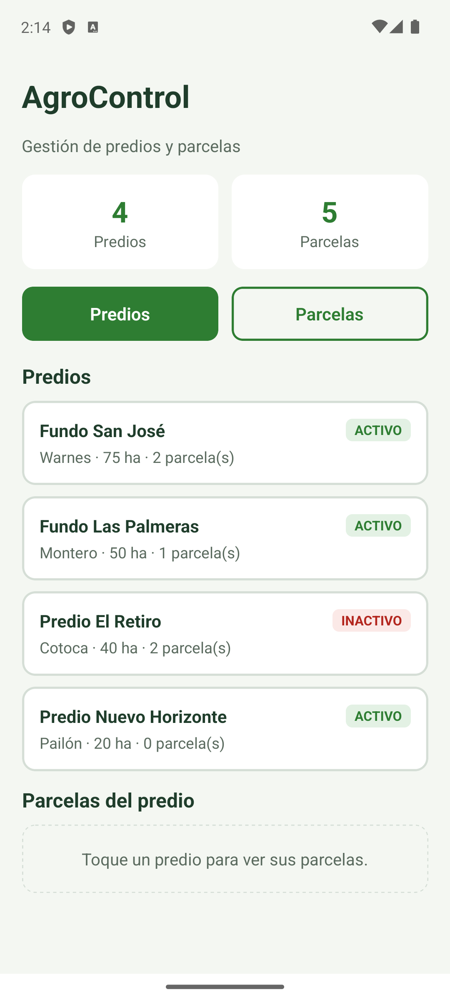
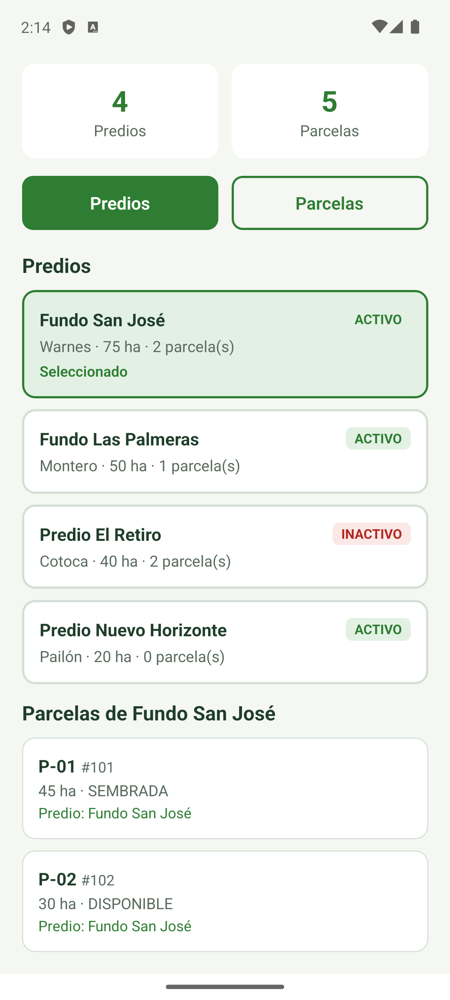
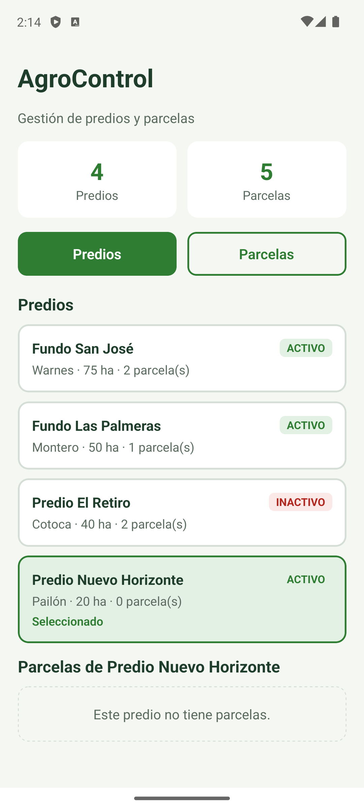
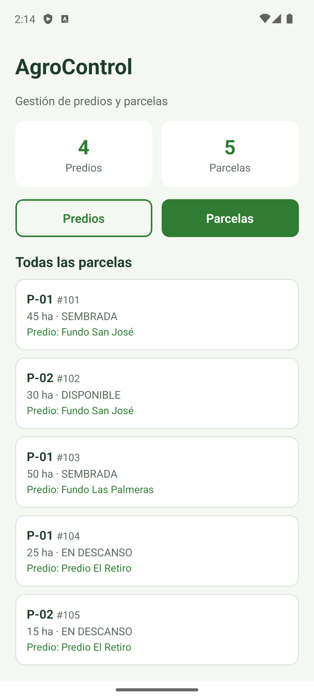

# AgroControl Móvil — Guías 01 y 02

App Expo + React Native + TypeScript (plantilla `blank-typescript`). Adapta ParkFlow360 Mobile al dominio de AgroControl:
**Cliente → Predio** y **Vehículo → Parcela** (relación 1:N por `predioId`).

> Conectada al backend: la app pide login (`POST /api/auth/login`, usuarios semilla con contraseña `agro123`)
> y carga predios, parcelas, cultivos, campañas, labores, incidencias y cosechas de la API con el token JWT
> (`src/api/cliente.ts`). Deslizar hacia abajo recarga. Sin backend, el botón **Ver datos de demostración**
> usa los datos ficticios de `src/data/demoData.ts` (los de las guías 01 y 02).

## Conectar con el backend

1. Levantar el backend: `./iniciar.sh` en la raíz del repo (Docker, puerto 8080).
2. En el login, **Servidor**:
   - Emulador de Android: `http://10.0.2.2:8080` (viene por defecto).
   - Teléfono real con Expo Go: `http://<IP-de-la-PC>:8080` (misma red Wi-Fi). También se puede fijar
     con `EXPO_PUBLIC_API_URL=http://<IP>:8080` en `agrocontrol-mobile/.env`.
3. Entrar con `jefe@agrocontrol.com` / `agro123` (u otro usuario semilla). Lo que se ve depende del rol:
   el operario solo recibe sus labores asignadas y no ve cosechas.

## Ejecutar

```bash
node -v && npm -v
adb devices -l            # el emulador debe aparecer como "device"
cd agrocontrol-mobile
npm install
npx expo start            # tecla "a" con el emulador abierto
npx tsc --noEmit          # revisión de tipos, sin generar JS
```

## Guía 01 (commit propio)

`App.tsx` único: dos `Pressable` (Predios / Parcelas), `useState<Seccion>`, ternario
"Módulo Predios" / "Módulo Parcelas", contadores en **0**, `SafeAreaView` + `ScrollView` y
`accessibilityRole="button"`.

Flujo: toque → `onPress` → `setSeccion` → re-render. Ningún paso consulta Spring Boot.

## Guía 02 — estructura (9 archivos)

| Archivo | Responsabilidad |
|---|---|
| `App.tsx` | Dueño del estado (`seccion`, `predioId`); deriva datos y compone |
| `src/models/agro.ts` | Tipos `Predio`, `Parcela`, `Seccion` (contrato, no datos) |
| `src/data/demoData.ts` | `PREDIOS` y `PARCELAS` ficticios |
| `src/theme/palette.ts` | Colores centralizados (`PALETTE`) |
| `src/components/MetricCard.tsx` | Métrica reutilizable |
| `src/components/TabSelector.tsx` | Cambia de sección (avisa con `alCambiar`) |
| `src/components/PredioCard.tsx` | Presenta un predio; avisa con `alSeleccionar` |
| `src/components/ParcelaCard.tsx` | Presenta una parcela con su predio |
| `src/components/EmptyState.tsx` | Lista vacía ≠ error |

Estado derivado (no se guarda en otro `useState`):

```ts
const predioElegido = PREDIOS.find((p) => p.id === predioId) ?? null;
const parcelasElegidas = predioElegido
  ? PARCELAS.filter((p) => p.predioId === predioElegido.id)
  : [];
```

## Casos de aceptación

| # | Caso | Resultado esperado |
|---|---|---|
| 1 | Fundo San José (id 1) | Dos parcelas: 101 y 102 |
| 2 | Fundo Las Palmeras (id 2) | Una parcela: 103 |
| 3 | Predio El Retiro (id 3) | **INACTIVO** y dos parcelas: 104 y 105 |
| 4 | Predio Nuevo Horizonte (id 4) | `EmptyState`: "Este predio todavía no tiene parcelas." |
| 5 | Pestaña Parcelas | Cinco tarjetas, cada una con su predio |
| 6 | `npx tsc --noEmit` | Termina sin errores |

| Inicio | San José | Sin parcelas | Todas |
|---|---|---|---|
|  |  |  |  |

## Detalle del predio (después de las guías)

Tocar un predio abre su pantalla (`PredioDetalle`); "‹ Volver a predios" o el botón atrás de Android regresan a la lista. Muestra:

- Datos del predio (ubicación, hectáreas totales y en parcelas, aviso si está inactivo), conteos y la barra de estado del campo.
- Una ficha completa por parcela (`ParcelaDetalle`): área y % del predio, **siembra actual** con etapa y avance del ciclo, **labores** de la campaña (hechas, en curso, pendientes y la próxima), **incidencias** (sin atender, en atención, resueltas) y **campañas anteriores** con su cosecha y rendimiento en t/ha.

Todo sale de `src/data/demoData.ts` (se agregaron `LABORES`, `COSECHAS`, `INCIDENCIAS` y campañas finalizadas) y se calcula en `src/logic/detalleParcela.ts`: no se guarda nada derivado. Los modelos siguen siendo espejo del backend (`Labor`, `Cosecha`, `Incidencia`), así que cuando la app consuma la API solo cambia de dónde vienen los arreglos.

## Preguntas de defensa

- **¿Por qué `predioId` vive en App y no en cada `PredioCard`?** Una sola fuente de verdad: si cada tarjeta guardara su selección, podrían quedar dos seleccionadas a la vez. La tarjeta recibe `seleccionado` como prop y avisa con `alSeleccionar`; App llama `setPredioId`.
- **¿Qué pasa con `onPress={alSeleccionar()}`?** La función se ejecuta durante el render (no al tocar), cambia estado en cada render y provoca un bucle. Lo correcto es `onPress={() => alSeleccionar(predio.id)}`.
- **¿Cómo sabe la app que San José tiene dos parcelas?** `PARCELAS.filter(p => p.predioId === 1)` conserva 101 y 102. `find` no sirve porque devuelve solo el primero.
- **¿TypeScript garantiza que `predioId` exista?** No: `predioId: 999` sigue siendo `number`. Eso lo garantiza la foreign key `parcela.id_predio → predio.id_predio` en PostgreSQL.
- **¿Por qué Nuevo Horizonte muestra vacío y no error?** El predio existe y `filter` devuelve `[]`, un resultado válido. Un error HTTP aparecerá recién cuando se consuma la API.
- **¿Por qué `key={predio.id}` y no el índice?** El id es la identidad estable; el índice cambia si se inserta un elemento al inicio.
